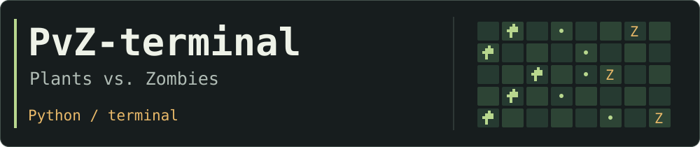
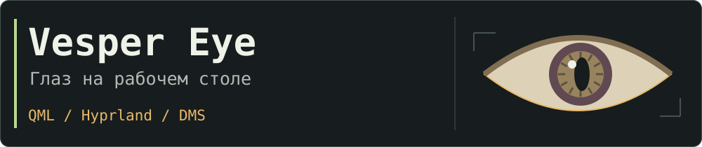
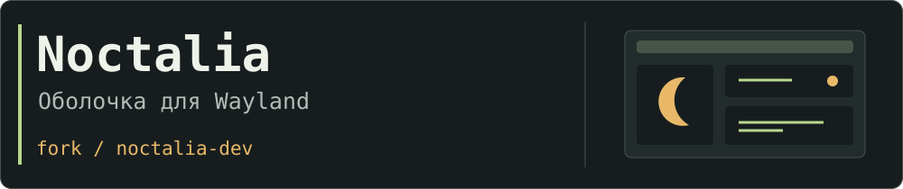
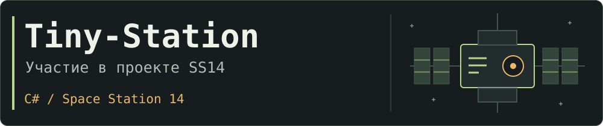

Пишу на **Python, C и Bash**. Разбираюсь в Linux, сетях и низкоуровневом коде:
маршрутизация, туннели, автоматизация и инструменты для администрирования.

## Проекты

Растения, зомби и всё поле в терминале. Написано на Python.
[Запуск и управление](https://github.com/Mister-EL/PvZ-terminal#readme).

Глаз для DankMaterialShell: следит за указателем, моргает и реагирует на нажатия.
QML, Hyprland и Quickshell. Версия для DMS пока в preview.

Мой форк [Noctalia](https://github.com/noctalia-dev/noctalia), оболочки для Wayland.
Исходный проект принадлежит команде Noctalia.

Участвую в поддержке Tiny-Station, форка Space Station 14.
Репозиторий организации, стек C#.
