  <a href="https://github.com/Mister-EL?tab=repositories">
    <picture>
      <source media="(max-width: 600px)" srcset="assets/hero-oil-phone.svg">
      
    </picture>
  </a>

Основа — **сети и Linux**: маршрутизация, туннели, автоматизация, инструменты для администрирования, местами низкоуровневый код.

  <a href="https://github.com/Mister-EL?tab=repositories">
    <picture>
      <source media="(max-width: 600px)" srcset="assets/strip-link-phone.svg">
      
    </picture>
  </a>

  

